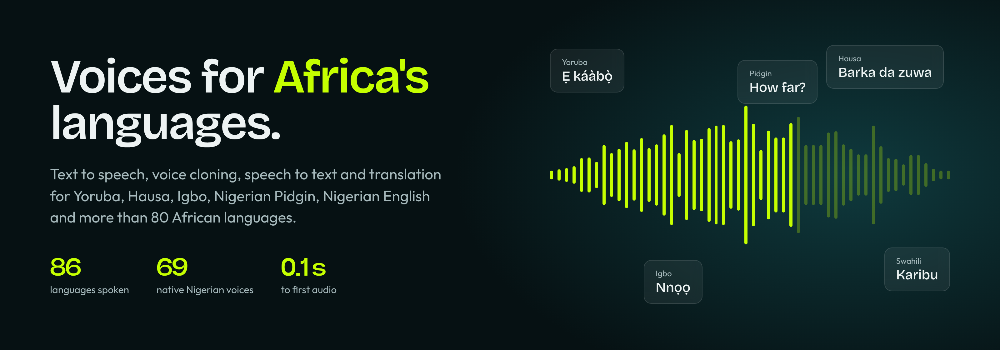

<p align="center">
  
</p>

# PlotWeaver Docs

The documentation for the **PlotWeaver developer API** and the **PlotWeaver MCP**: text to speech, voice cloning, speech to text and translation for Yoruba, Hausa, Igbo, Nigerian Pidgin, Nigerian English and more than 80 African languages.

**Read it at [plotweaver.mintlify.app](https://plotweaver.mintlify.app).**

| | |
|---|---|
| Developer API | `https://api.plotweaver.app/v1` |
| MCP server | `https://mcp.plotweaver.app/mcp` |
| Dashboard and API keys | [app.plotweaver.app](https://app.plotweaver.app) |
| Pricing | [plotweaver.app/pricing](https://plotweaver.app/pricing) |
| Support | [info@plotweaver.app](mailto:info@plotweaver.app) |

## Start here

- [Quickstart](https://plotweaver.mintlify.app/quickstart): your first Yoruba audio in under two minutes
- [Connect your AI assistant](https://plotweaver.mintlify.app/mcp/overview): Claude, ChatGPT, Claude Code, Cursor and VS Code
- [API reference](https://plotweaver.mintlify.app/api-reference/introduction): every endpoint, with a live playground
- [Languages](https://plotweaver.mintlify.app/languages) and [voices](https://plotweaver.mintlify.app/voices)

## What's in this repository

```
docs.json                  site settings and navigation
index.mdx, *.mdx           guides
build/                     end-to-end recipes (phone agent, subtitles, announcements, narration)
mcp/                       the PlotWeaver MCP: connecting each app, tools, files, security
api-reference/             the API reference (openapi.json) and the real-time WebSocket protocol
images/, logo/             artwork
```

The site is built with [Mintlify](https://mintlify.com) and deploys automatically when `main` changes.

## Preview locally

```bash
npm i -g mint
mint dev
```

Open http://localhost:3000. Before pushing, check the build and links:

```bash
mint validate
mint broken-links
```

## Writing guidelines

See [AGENTS.md](AGENTS.md). In short: plain, direct sentences; real, working examples; Yoruba always with full tone marks and underdots; no em dashes.

---

© PlotWeaver Limited, Company No. 16189457, London, United Kingdom.
