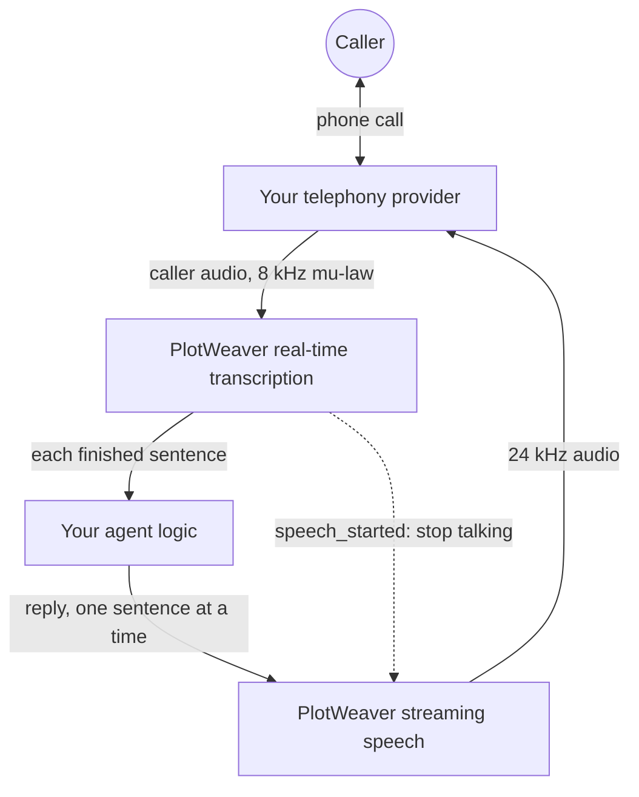

A voice agent on a phone line needs three things to feel human: it must hear the caller quickly, answer quickly, and stop talking when the caller interrupts. PlotWeaver covers the hearing and the speaking; your own logic (a language model, a menu, your business rules) decides what to say.



## 1. Hear the caller

Open one [real-time transcription](/realtime-transcription) socket per call and forward the call audio exactly as your telephony provider delivers it. Most phone networks deliver 8 kHz mu-law, which the socket takes directly:

```python
ASR_URL = (
    "wss://api.plotweaver.app/v1/transcriptions/stream"
    "?sample_rate=8000&encoding=mulaw&endpoint_ms=600"
)
```

`endpoint_ms` decides how long a pause ends the caller's turn. 500 to 700 ms suits most conversations; raise it for callers who pause to think.

## 2. Decide the answer

When a `final` event arrives, hand the text to your agent logic. STORM ASR 2.0 understands code-mixed speech, so "Abeg I wan check my balance" and "Mo fẹ́ mọ̀ iye owó tó wà nínú àkáǹtì mi" both arrive as clean text without you telling it the language.

Reply in the language the caller used. If your agent logic works in English, [translate](/translation) the reply before speaking it.

## 3. Speak the reply

Send the reply to [streaming speech](/streaming-speech) **one sentence at a time**, as soon as each sentence is ready. The first sentence starts playing in about 0.1 seconds while the next is still being written.

```python
async def say(sentence: str, language: str, voice_id: str):
    async with http.stream(
        "POST",
        "https://api.plotweaver.app/v1/speech/stream",
        headers={"X-API-Key": API_KEY},
        json={"text": sentence, "language": language, "voice_id": voice_id, "mode": "speed"},
    ) as r:
        async for chunk in r.aiter_bytes():
            await call.play(pcm24k_to_phone(chunk))  # resample 24 kHz PCM to your line's format
```

## 4. Let the caller interrupt

The transcription socket sends `speech_started` the moment the caller begins talking. Stop playback and cancel the current speech request right there. Because you speak one sentence per request, an interruption costs only the sentence in progress.

```python
if event["event"] == "speech_started":
    await call.stop_playback()
    current_speech_task.cancel()
```

## Choosing voices

Pick a voice whose native language matches the caller's: `tega` or `ufuoma` for Pidgin, `aderonke` or `kola` for Yoruba, `maryam` or `ibrahim` for Hausa, `chinwe` or `chidi` for Igbo, `joseph` or `tola` for Nigerian English. Or [clone](/voice-cloning) your brand's own voice once and use it in all five languages.

## Production checklist

<AccordionGroup>
  <Accordion title="Keep the key on your server">
    Open both the transcription socket and the speech requests from your call server, never from a phone or browser.
  </Accordion>
  <Accordion title="Plan for capacity">
    Each account runs up to 8 real-time transcription connections and up to 12 speech requests with built-in voices at once. Size your concurrent calls to fit, and talk to us before a large campaign.
  </Accordion>
  <Accordion title="Handle 429 gracefully">
    A `429` with `Retry-After` means a service is at capacity right now. Play a short pre-recorded holding line, then retry.
  </Accordion>
  <Accordion title="Pre-record the fixed prompts">
    Greetings, menus and hold messages never change. Generate them once with `POST /v1/speech` (best quality) and play the files.
  </Accordion>
  <Accordion title="Log the request ids">
    Keep `X-Request-ID` from each speech response and the `utterance_id` of each transcript, so a bad turn can be traced end to end.
  </Accordion>
</AccordionGroup>
