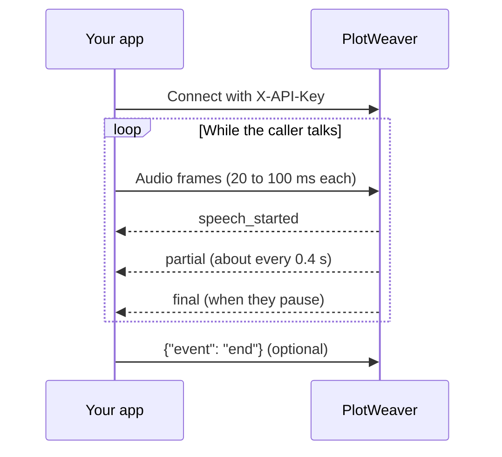

For live calls and voice agents, stream audio to `wss://api.plotweaver.app/v1/transcriptions/stream` as it is captured. STORM ASR 2.0 hears when the speaker starts and stops talking, sends the transcript so far about every 0.4 seconds, and sends the finished sentence as soon as they pause.



## Connect

Send your key in the `X-API-Key` header. Clients that cannot set headers, such as browsers, can pass it as `api_key=` in the query string; open the socket from your server whenever you can.

| Query parameter | Default | Meaning |
|---|---|---|
| `sample_rate` | `16000` | Sample rate of the audio you send, 8000 to 48000 |
| `encoding` | `pcm_s16le` | `pcm_s16le` (signed 16-bit little-endian) or `mulaw` (8-bit phone audio) |
| `endpoint_ms` | `700` | How long a pause ends a sentence, 200 to 5000 ms. Lower answers faster; higher lets slow speakers pause mid-sentence |
| `language` | none | Optional, recorded with the request. The model does not need it |

For a phone line, send the call audio exactly as your telephony provider delivers it:

```
wss://api.plotweaver.app/v1/transcriptions/stream?sample_rate=8000&encoding=mulaw
```

## Messages

| Direction | Message | Meaning |
|---|---|---|
| You send | Binary frames | Raw mono audio in the format above. Send small frames (20 to 100 ms) as they are captured |
| You send | `{"event": "end"}` | Optional: finish the current sentence now instead of waiting for the pause |
| We send | `{"event": "speech_started", "utterance_id": 1, "start_s": 3.42}` | The speaker started talking. Use it to stop your agent talking over them |
| We send | `{"event": "partial", "text": "...", "utterance_id": 1}` | The sentence so far, about every 0.4 s while they speak |
| We send | `{"event": "final", "text": "...", "utterance_id": 1, "start_s": 3.42, "end_s": 6.10}` | The finished sentence, once they pause |
| We send | `{"event": "heartbeat"}` | The connection is alive |
| We send | `{"event": "error", "status": 401, "detail": "..."}` | The request was refused; the socket then closes |

One connection carries a whole conversation. Each sentence gets its own `utterance_id`, and you keep streaming after a `final`.

## Example


```python tab="Python"
import asyncio
import json
import os

from websockets.asyncio.client import connect

URL = "wss://api.plotweaver.app/v1/transcriptions/stream"  # 16 kHz PCM16 by default


async def transcribe(pcm: bytes) -> list[str]:
    finals: list[str] = []
    headers = {"X-API-Key": os.environ["PLOTWEAVER_API_KEY"]}
    async with connect(URL, additional_headers=headers) as ws:

        async def listen():
            async for message in ws:
                event = json.loads(message)
                if event["event"] == "partial":
                    print("...", event["text"])
                elif event["event"] == "final":
                    finals.append(event["text"])
                elif event["event"] == "error":
                    raise RuntimeError(event["detail"])

        listener = asyncio.create_task(listen())
        for i in range(0, len(pcm), 3200):  # 100 ms frames, sent in real time
            await ws.send(pcm[i : i + 3200])
            await asyncio.sleep(0.1)
        await ws.send(json.dumps({"event": "end"}))
        await asyncio.sleep(1)
        listener.cancel()
    return finals
```

```javascript tab="Node.js"
import WebSocket from "ws";

const ws = new WebSocket("wss://api.plotweaver.app/v1/transcriptions/stream", {
  headers: { "X-API-Key": process.env.PLOTWEAVER_API_KEY },
});

ws.on("message", (data, isBinary) => {
  if (isBinary) return;
  const event = JSON.parse(data.toString());
  if (event.event === "speech_started") stopAgentSpeaking();
  if (event.event === "partial") showLiveCaption(event.text);
  if (event.event === "final") handleTurn(event.text);
  if (event.event === "error") console.error(event.status, event.detail);
});

// Send 16 kHz, 16-bit mono PCM frames as your microphone or call delivers them:
// ws.send(frame);
```


## Limits and errors

- One connection carries up to **30 minutes** of audio, and closes after **30 seconds** without any message from you.
- Up to **8 connections per account** at once.
- Refusals use the same status codes as the HTTP endpoints (`401`, `402`, `403`, `429`), sent as an `error` event. The close code is 4000 plus the status, so `4401` for a bad key.
- When the service is at capacity, the connection is refused at once with `{"event": "error", "status": 429, "retry_after_s": 5}` and close code `4429`. Retry after that many seconds.

## Billing

Billed per second of audio you send, however the connection ends.
