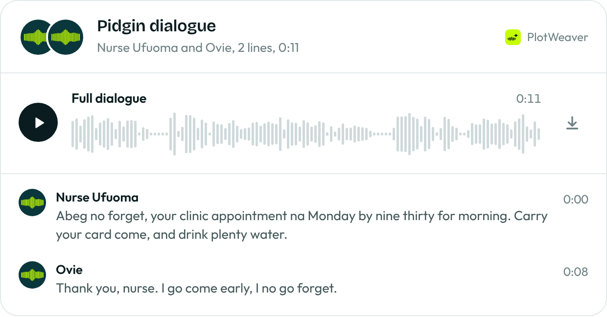

PlotWeaver connects to ChatGPT as a custom MCP server with **Sign in with PlotWeaver**.

<Steps>
  <Step title="Open plugins">
    In ChatGPT on the web, go to [chatgpt.com/plugins](https://chatgpt.com/plugins).
  </Step>
  <Step title="Add a custom MCP server">
    Select **+**, then **Add custom MCP server**.
  </Step>
  <Step title="Enter the server">
    | Field | Value |
    |---|---|
    | Name | `PlotWeaver` |
    | Description | `Speech, voice cloning, transcription and translation for Nigerian and African languages` |
    | Server URL | `https://mcp.plotweaver.app/mcp` |
    | Authentication | **OAuth** |

    PlotWeaver registers ChatGPT automatically, so there is no client ID or secret to enter.
  </Step>
  <Step title="Create and install">
    Read the notice, select **I understand and want to continue**, then **Create as a plugin**. Install it from your personal plugins.
  </Step>
  <Step title="Sign in with PlotWeaver">
    The first time you use it, a PlotWeaver page opens. Sign in with your PlotWeaver account and press **Approve**.
  </Step>
</Steps>

<Note>
Workspace plans (Business, Enterprise, Edu) may need an admin to allow custom MCP servers first.
</Note>

## Use it in a chat

Ask for something PlotWeaver does, or mention PlotWeaver by name:

> Announce "We are open on Saturday" in Yoruba, Hausa, Igbo, Pidgin and English.

Results play in the chat with the PlotWeaver player, with a download button for every file.

<Frame>
  
</Frame>

## Disconnect

Remove the plugin in ChatGPT, or delete the "ChatGPT connector" key in your PlotWeaver dashboard under **API Keys**.
