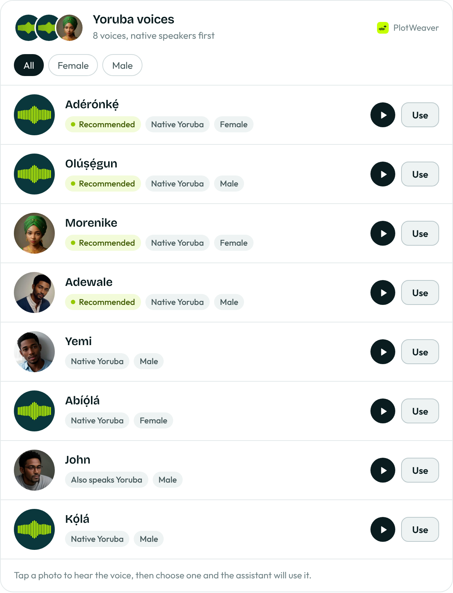
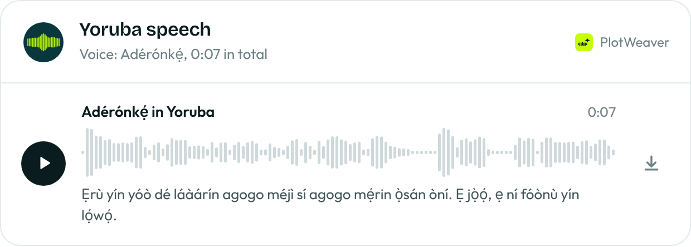

PlotWeaver works in Claude on the web, desktop and mobile. You add it once on the web or desktop, and it is available on every device signed in to your Claude account.

Custom connectors are available on every Claude plan. The Free plan allows one custom connector.

## Pro and Max

<Steps>
  <Step title="Open connectors">
    In Claude, go to **Customize > Connectors**.
  </Step>
  <Step title="Add a custom connector">
    Select **+ Add**, then **Add custom connector**.
  </Step>
  <Step title="Enter the server">
    | Field | Value |
    |---|---|
    | Name | `PlotWeaver` |
    | Remote MCP server URL | `https://mcp.plotweaver.app/mcp` |

    Select **Continue**. Claude detects that PlotWeaver uses OAuth sign-in; keep the detected settings and continue.
  </Step>
  <Step title="Sign in with PlotWeaver">
    Choose to sign in now. A PlotWeaver page opens: sign in with your PlotWeaver account and press **Approve**.
  </Step>
</Steps>

## Team and Enterprise

An organisation owner adds the connector once for everyone:

<Steps>
  <Step title="Add it for the organisation">
    Go to **Organization settings > Connectors**, select **Add**, hover over **Custom** and select **Web**. Enter the name `PlotWeaver` and the URL `https://mcp.plotweaver.app/mcp`, then **Add**.
  </Step>
  <Step title="Each member connects">
    Each member goes to **Customize > Connectors**, finds PlotWeaver and selects **Connect**, then signs in with their own PlotWeaver account.
  </Step>
</Steps>

Each member's usage goes to their own PlotWeaver account.

## Use it in a chat

Select **+** at the bottom left of the message box, then **Connectors**, and make sure PlotWeaver is on. Then just ask:

> Show me Yoruba voices for a delivery update.

<Frame>
  
</Frame>

> Read this in Yoruba with Adérónkẹ́'s voice: "Your order will arrive between 2 and 4 pm today."

<Frame>
  
</Frame>

## Your own voice, from your phone

Chat apps turn speech into text, so Claude can't hear a voice note directly. Ask "Clone my voice" and Claude gives you a one-time PlotWeaver recording page: record a few seconds on your phone or computer, confirm your permission, and tell Claude you're done.

## Files you attach

Files you attach in Claude (audio, video, PDFs, Word documents) are sent to PlotWeaver from Claude's own workspace, so you never upload anything twice. See [Files and audio](/mcp/files-and-audio).

## Disconnect

Remove PlotWeaver under **Customize > Connectors**, or delete the "Claude connector" key in your PlotWeaver dashboard under **API Keys**. Either one ends access at once.
