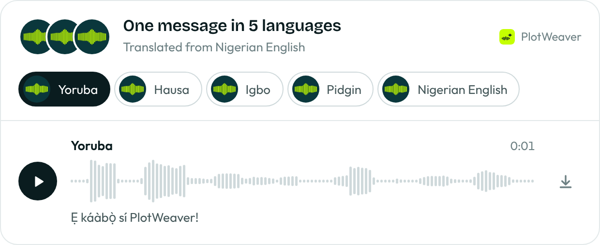

The PlotWeaver MCP connects AI assistants to PlotWeaver's speech AI through the [Model Context Protocol](https://modelcontextprotocol.io). Add it once and your assistant can speak in 86 languages, clone a voice, transcribe and subtitle Nigerian speech, and translate between Nigerian languages, all from plain conversation.

<Frame caption="One request in Claude: 'Say our welcome message in Yoruba, Hausa, Igbo, Pidgin and English.'">
  
</Frame>

## Server address

```
https://mcp.plotweaver.app/mcp
```

A remote server over Streamable HTTP. Nothing to install, nothing to run.

## Connect your assistant

<CardGroup cols={3}>
  <Card title="Claude" icon="message" href="/mcp/claude">
    claude.ai, desktop and mobile
  </Card>
  <Card title="ChatGPT" icon="comments" href="/mcp/chatgpt">
    As a custom plugin
  </Card>
  <Card title="Claude Code" icon="terminal" href="/mcp/claude-code">
    One command
  </Card>
  <Card title="Cursor" icon="arrow-pointer" href="/mcp/cursor">
    `mcp.json`
  </Card>
  <Card title="VS Code" icon="code" href="/mcp/vscode">
    GitHub Copilot agent mode
  </Card>
  <Card title="Other clients and SDKs" icon="plug" href="/mcp/other-clients">
    Windsurf, any MCP client, and the Claude and OpenAI APIs
  </Card>
</CardGroup>

## Two ways to sign in

| | Sign in with PlotWeaver | API key |
|---|---|---|
| **How** | The app opens a PlotWeaver page; you sign in and press **Approve** | You paste a key into the app's MCP settings |
| **Best for** | Claude, ChatGPT, Claude Code | Cursor, VS Code, scripts and SDKs |
| **Key handling** | A key named after the app (for example "Claude connector") is created for you and never leaves our server | You manage the key yourself |
| **Disconnect** | Delete that key in the dashboard | Delete or rotate the key |

Both run on your own PlotWeaver account: usage, limits and billing are exactly the same as for API calls. See [Sign-in and security](/mcp/sign-in-and-security).

## What your assistant can do

<CardGroup cols={2}>
  <Card title="Speak" icon="waveform-lines">
    Voiceovers, narration, ads and announcements, from one line to a whole script, one file per scene.
  </Card>
  <Card title="Hold conversations" icon="users">
    Scripts with several speakers in their own voices, mixed into one file with a timeline.
  </Card>
  <Card title="Speak five languages at once" icon="language">
    Translate one message and voice it in English, Yoruba, Hausa, Igbo and Pidgin.
  </Card>
  <Card title="Transcribe and subtitle" icon="closed-captioning">
    Audio or video of any length, code-mixed speech included, with optional translation.
  </Card>
  <Card title="Clone a voice" icon="user">
    From a short recording, with the speaker's permission collected on a recording page.
  </Card>
  <Card title="Read documents aloud" icon="file-lines">
    Web pages, PDFs and Word files turned into speech.
  </Card>
</CardGroup>

In Claude, ChatGPT and VS Code, results play right in the chat with a PlotWeaver player, and `find_voices` shows a voice gallery you can listen to and pick from.

See [Example prompts](/mcp/prompts) and the full [tools reference](/mcp/tools).

## What you need

1. A PlotWeaver account. Get one at [app.plotweaver.app](https://app.plotweaver.app).
2. An AI app that supports remote MCP servers: any of the ones above.

That's all. The listing is also in the [official MCP Registry](https://registry.modelcontextprotocol.io) as `app.plotweaver.mcp/plotweaver`.
