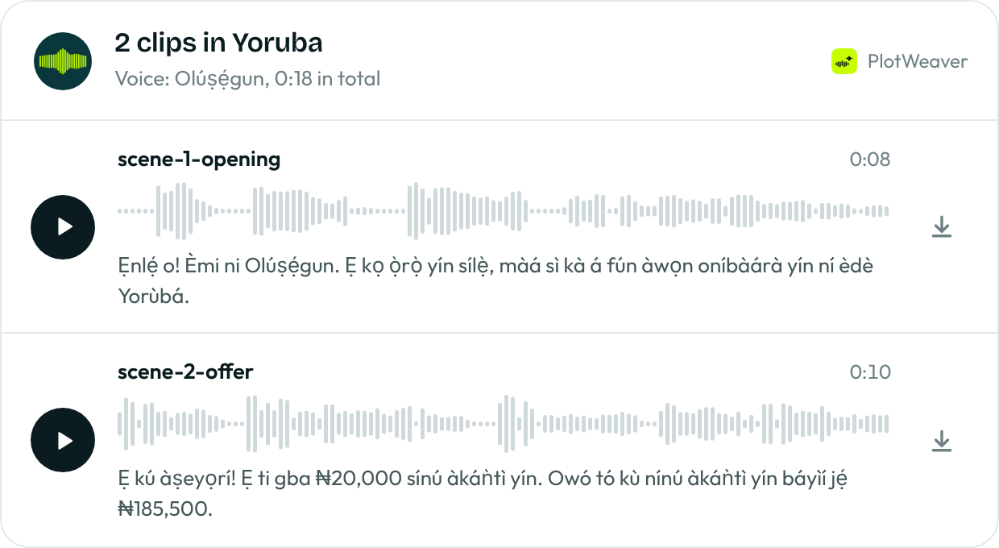

You don't need to name tools. Say what you want; your assistant picks the tools and chains them.

## Voice and audio

| Ask | What happens |
|---|---|
| "Show me Yoruba voices for a delivery update." | `find_voices` opens a gallery you can play and pick from |
| "Read this in Yoruba with Adérónkẹ́: 'Your order will arrive between 2 and 4 pm today.'" | `speak` returns a player and a download link |
| "Make a Yoruba voiceover for my product video, one clip per scene." | The assistant writes a line per scene, then `speak` with `segments` returns one file per scene, each with its exact length |
| "Make a 30 second Pidgin radio ad with a customer and an agent." | `create_dialogue` voices each speaker and mixes one file, with a timeline of every line |
| "Say our welcome message in Yoruba, Hausa, Igbo, Pidgin and English." | `speak_in_languages` translates and voices all five |
| "Read this article aloud in Nigerian English: https://..." | `read_document` takes the article text, `estimate_cost` prices a long one first, then `speak` |

<Frame caption="'Make a Yoruba voiceover for my product video, one clip per scene.'">
  
</Frame>

## Listening

| Ask | What happens |
|---|---|
| "Subtitle this Hausa interview in English." (with the video attached) | `upload_file` sends the video, then `transcribe_audio` with `translate_to: "en"` returns timed, translated segments |
| "Transcribe this voice note and tell me what she wants." | `transcribe_audio`, then the assistant answers from the transcript |
| "What does this voiceover actually say?" | `transcribe_audio` on the generated audio, to check it word by word |

## Your voice

| Ask | What happens |
|---|---|
| "Clone my voice." | `record_voice` gives you a one-time page to record on and confirm your permission, then `clone_voice` saves it |
| "Clone my voice from 0:42 to 0:50 of this video." | `upload_file`, then `clone_voice` with `start_s` and `end_s` |
| "Now say our product launch line in Hausa with my voice." | `speak` with your new `voice_id`. Voices cloned in a Nigerian language speak all five |

## Account

| Ask | What happens |
|---|---|
| "How much would it cost to voice this whole chapter?" | `estimate_cost` at your account's rates, with what's left of your allowance |
| "How much have I used this month?" | `get_account` |
| "Rename my voice 'Tunde narrator' to 'Tunde'." | `rename_voice` |

## Tips for great results

- **Name the language and the use.** "A warm Yoruba voice for a bank's customer line" picks better than "a Yoruba voice".
- **Give the exact words when they matter.** Put the text in quotes and the assistant voices it as written.
- **Write Yoruba with tone marks** when you give the text yourself.
- **Ask for one clip per scene** for video work: each file comes back with its exact duration, ready for the timeline.
