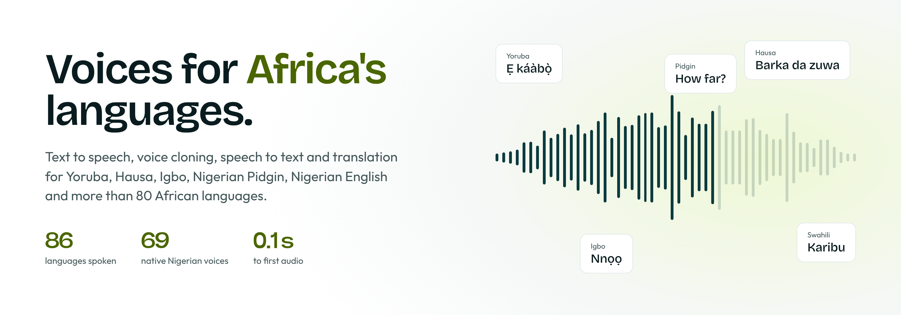
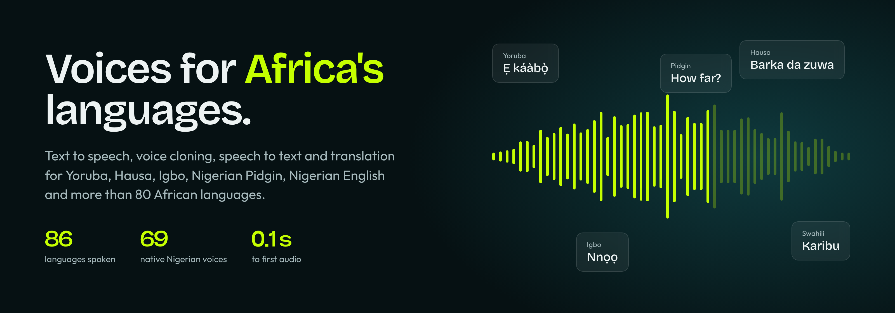

PlotWeaver builds speech AI for the languages most products leave out. One API gives you natural text to speech in Yoruba, Hausa, Igbo, Nigerian Pidgin, Nigerian English and more than 80 African languages, voice cloning from a few seconds of audio, speech to text that understands code-mixed Nigerian speech, and translation built for Nigerian names, places and phrasing.

Everything is also available to AI agents through the **PlotWeaver MCP**, so Claude, ChatGPT, Cursor, VS Code and Claude Code can speak, listen and translate for you in plain conversation.

<CardGroup cols={2}>
  <Card title="Quickstart" icon="rocket" href="/quickstart">
    Your first Yoruba audio file in under two minutes.
  </Card>
  <Card title="Connect your AI assistant" icon="sparkles" href="/mcp/overview">
    Add PlotWeaver to Claude, ChatGPT, Cursor, VS Code or Claude Code.
  </Card>
</CardGroup>

## What you can build

<CardGroup cols={3}>
  <Card title="Text to speech" icon="waveform-lines" href="/text-to-speech">
    69 native Nigerian voices, each able to speak all five Nigerian languages, plus voices for more than 80 African languages.
  </Card>
  <Card title="Streaming speech" icon="bolt" href="/streaming-speech">
    First audio in about 0.1 seconds, for live calls and voice agents.
  </Card>
  <Card title="Voice cloning" icon="user" href="/voice-cloning">
    A reusable voice from 5 to 10 seconds of one person, with consent built in.
  </Card>
  <Card title="Speech to text" icon="closed-captioning" href="/speech-to-text">
    STORM ASR 2.0: no language needed, code-mixed speech, full tone marks, subtitles.
  </Card>
  <Card title="Real-time transcription" icon="phone-volume" href="/realtime-transcription">
    A WebSocket that hears when a caller starts and stops, built for phone lines.
  </Card>
  <Card title="Translation" icon="language" href="/translation">
    Any pair of English, Yoruba, Hausa, Igbo and Nigerian Pidgin.
  </Card>
</CardGroup>

## The STORM models

| Model | What it does |
|---|---|
| **STORM v1.5** (`storm-v1`) | Our flagship Nigerian voices: Yoruba, Hausa, Igbo, Nigerian Pidgin and Nigerian English, with full tonal control. |
| **STORM Gust 1.0** (`storm-gust`) | Fast voice cloning and the lowest-latency streaming in the five Nigerian languages. |
| **STORM Ensemble 3.0** (`storm-ensemble`) | Built-in voices for 57 African languages outside Nigeria, including languages no other model speaks. |
| **STORM v3** (`storm-v3`) | 70 African languages, with a preset voice or a cloned one. |
| **STORM ASR 2.0** | Speech to text for the five Nigerian languages and speech that mixes them. |
| **STORM MT** | Translation between English, Yoruba, Hausa, Igbo and Nigerian Pidgin. |

You rarely pick a model yourself. Send a language and a voice and the API routes the request to the right engine. See [Languages](/languages) and [Voices](/voices).

## Two ways in

<Tabs>
  <Tab title="Developer API">
    A REST API at `https://api.plotweaver.app/v1` with an API key in the `X-API-Key` header. Use it from any backend: Python, Node.js, Go, PHP, or plain `curl`.

    ```bash
    curl -X POST https://api.plotweaver.app/v1/speech \
      -H "X-API-Key: $PLOTWEAVER_API_KEY" \
      -H "Content-Type: application/json" \
      -d '{"text": "Ẹ kú àárọ̀, ẹ káàbọ̀ sí PlotWeaver.", "language": "yo"}' \
      --output welcome.wav
    ```
  </Tab>
  <Tab title="PlotWeaver MCP">
    A remote MCP server at `https://mcp.plotweaver.app/mcp`. Add it to your assistant once, sign in with your PlotWeaver account, then ask in plain words:

    > Make a Yoruba voiceover for my product video, one clip per scene.

    The assistant picks the voice, writes and voices each clip, and hands you files ready for your editor.
  </Tab>
</Tabs>

## Built for production

<CardGroup cols={2}>
  <Card title="Native speakers, real phonology" icon="microphone-lines">
    Every built-in Nigerian voice is a native speaker, and every language is its own system with its own tonal modelling and evaluation.
  </Card>
  <Card title="Text normalisation built in" icon="spell-check">
    Naira amounts, times, percentages and units are turned into words before they are spoken, so your voices never trip over symbols.
  </Card>
  <Card title="Clear limits, no surprises" icon="gauge-high">
    Per-plan request limits, honest `429` answers with `Retry-After`, and overflow to a second engine when one is busy.
  </Card>
  <Card title="One account for everything" icon="key">
    The same keys, usage and billing for the API and the MCP, with per-key usage in the dashboard.
  </Card>
</CardGroup>
